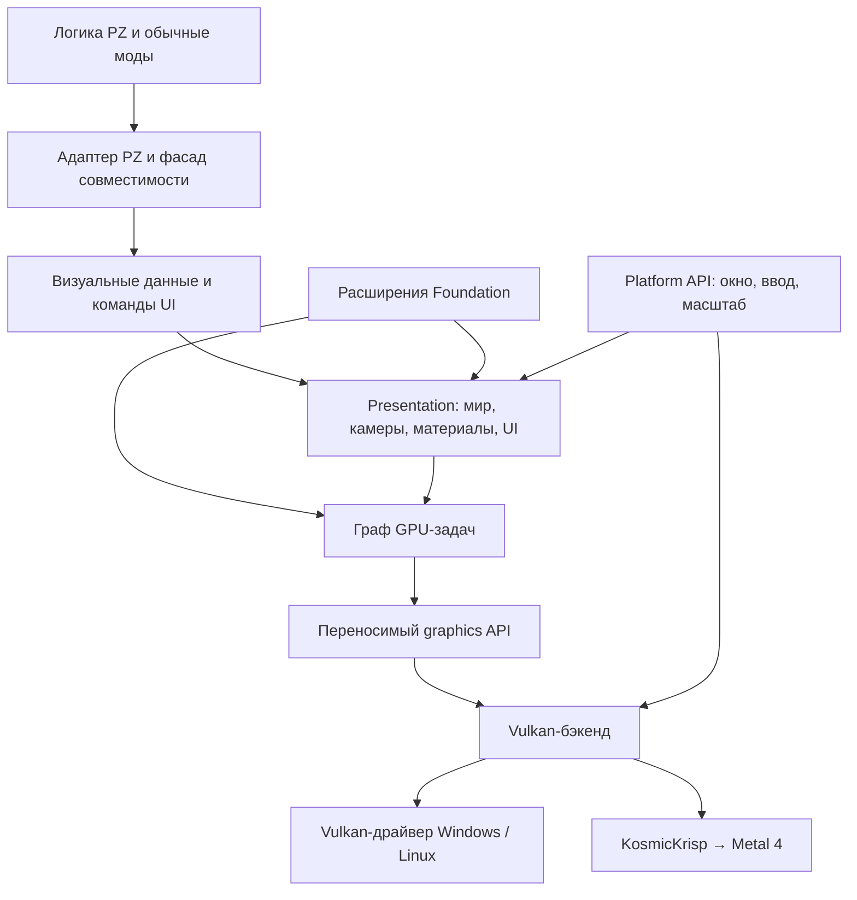

# Архитектура Project Foundation

Статус: принятая исходная граница проекта; детализация API — draft. Дата: 2026-10-21.

Foundation позволяет постепенно выделять подсистемы PZ, начиная с визуальной. Первая цель — штатный вид игры через Vulkan, работающий на Windows, Linux и современных Mac, с сохранением поведения обычных модов. Рост FPS не является условием начала работы. Корректность, переносимость и расширяемость — самостоятельные цели; регресс производительности при этом измеряется.

## Направление данных

Обычные моды продолжают работать через ванильные контракты PZ. Новый SDK нужен расширениям Foundation и модам, которые вмешиваются непосредственно в рендер.

## Границы

| Подсистема | Владеет | Принимает | Не зависит от |
|---|---|---|---|
| Foundation runtime | Жизненным циклом расширений и диагностикой | Манифесты возможностей и зависимости | PZ, Vulkan, GLFW |
| Адаптер PZ | Точками подключения конкретного билда и фасадом совместимости | Игровыми объектами и ванильными вызовами | Реализации Vulkan |
| Presentation | Представлением мира, камер, материалов, UI-команд | Визуальными данными и изменениями ресурсов | Классов PZ, Vulkan и GLFW |
| Graphics runtime | Планом GPU-задач и учётом ресурсов | Явными чтениями, записями и ограничениями порядка | Игровых понятий |
| Graphics backend | Устройством, памятью, очередями и выполнением команд | Согласованной графической работой | Логики игры |
| Platform | Окном, событиями ввода и характеристиками вывода | Платформенными событиями | Игрового мира |
| Reference mod | Конфигурацией готового приложения | Перечисленными компонентами | Новых игровых правил |

Композиция находится в референсном моде и инструментах. Бэкенд реализует SPI из `graphics-api`; graphics-runtime получает реализацию через этот SPI, без зависимости от `graphics-vulkan`. Platform передаёт абстрактную поверхность; native-доступ к окну согласуется при композиции и не протекает в presentation.

## Визуальные данные

Игровые объекты не передаются GPU-потоку по ссылке. Адаптер публикует согласованный снимок визуальных данных с номером кадра, эпохой мира, камерами и коэффициентом интерполяции. Постоянная геометрия и текстуры хранятся отдельно; снимок содержит идентификаторы, диапазоны и изменения. Выгрузка чанка и смена мира инвалидируют соответствующее состояние.

Идентификатор визуального объекта может связываться с игровой сущностью внутри адаптера. Обратное обращение к игре идёт через игровые команды в разрешённой фазе; рендер не меняет игровой мир. Ванильные render-callbacks исполняются в наблюдаемой ванильной фазе и записывают команды; их не переносят произвольно на GPU-поток и не вызывают повторно при replay.

## UI и окно

Сначала сохраняем ванильные layout, ввод, focus, hit testing и Lua-callbacks. Их вывод преобразуется в UI-команды Foundation. Самостоятельную UI-библиотеку не делаем условием перехода. Окно и ввод остаются отдельной границей, включая DPI, Retina, fullscreen и несколько локальных игроков.

## Ресурсы и граф

Ресурсы имеют владельца, поколение и срок использования. Граф описывает graphics-, compute- и transfer-задачи, чтения и записи ресурсов, внешние входы и результаты. Runtime проверяет зависимости и поручает бэкенду синхронизацию. Прозрачность, stencil и порядок ванильных UI-команд имеют явные ограничения: граф не может переставлять их ради batching.

Каждая камера может порождать собственный набор задач; названия семантических стадий не означают один-единственный глобальный проход. Асинхронная загрузка, readback и GPU compute — равноправные части графики.

## Стратегия переноса

1. Инвентаризировать ванильные контракты и все GL-пути, включая запуск, атласы, UI и вспомогательные изображения.
2. В адаптере преобразовать существующие команды в явные операции Foundation. Слой совместимости остаётся внутренним.
3. По подсистемам переводить presentation на подготовленные визуальные данные.
4. Сохранять ванильный фасад для обычных модов после удаления старой GL-реализации.

Не переносим глобальное состояние OpenGL в публичный API. Частичная реализация не маскирует неизвестную команду пропуском. Выбор бэкенда делается до начала сессии; переключение после частично отправленного GPU-кадра не является механизмом восстановления.

## Каркас и дальнейший рост

[Каталог модулей](../architecture/modules.json) — единственный источник графа сборки. Пакетный namespace `org.projectfoundation` предварительный; публикации в Maven нет. Контракты описаны в [отдельном документе](contracts.md).

Сеть, звук, сохранения и симуляцию можно выделять следующими самостоятельными изменениями. Сейчас не вводим ECS, универсальную шину всех событий или замену Lua. Каждая новая подсистема должна иметь собственное доказанное место разделения и план совместимости.
